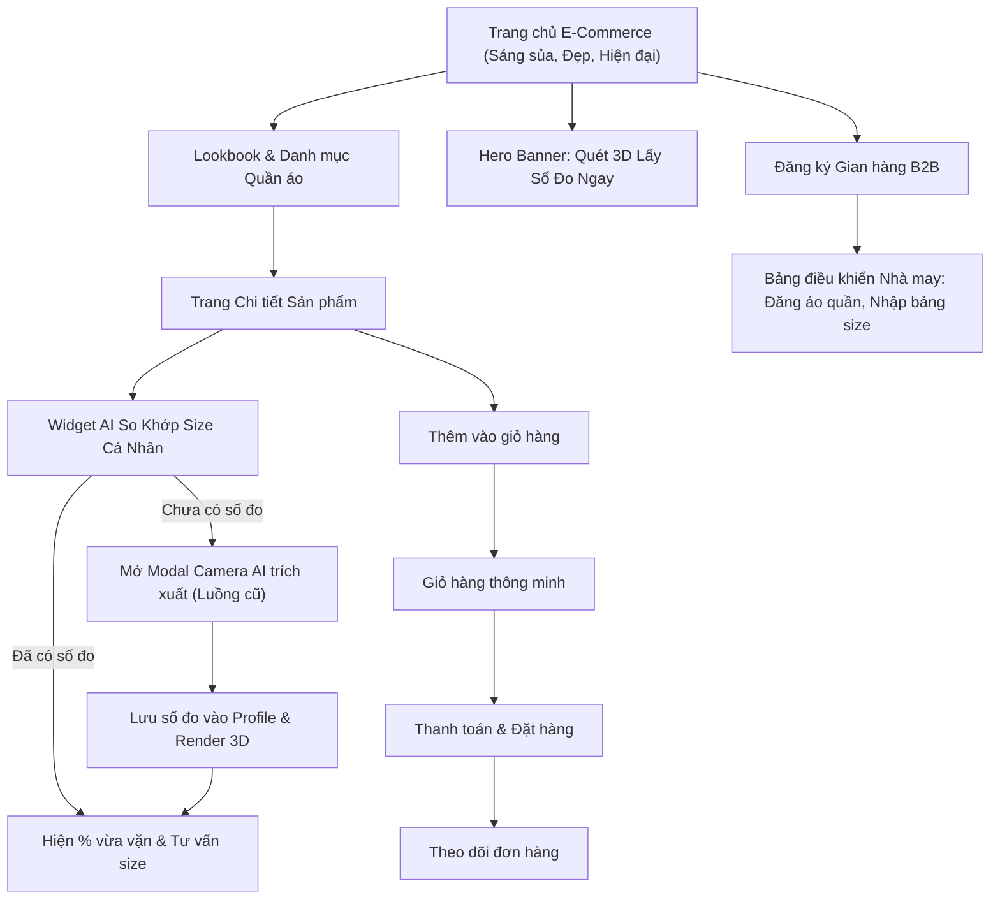

> **Người lập:** Antigravity AI Pair Programmer & Trưởng nhóm Lê Văn Thắng  
# 🚀 KẾ HOẠCH NÂNG CẤP TOÀN DIỆN FITVISION 3D: TỪ NCKH THÀNH ĐỒ ÁN CAPSTONE THỜI TRANG 3D THƯƠNG MẠI
> **Dự án:** FitVision 3D (Mã học phần: C1SE.12)  
> **Trạng thái:** Bản thảo quy hoạch & Thiết kế giao diện (Chưa đẩy lên GitHub)

---

## 🎯 1. BỐI CẢNH & TẠI SAO PHẢI THÊM E-COMMERCE?

### ❌ Thực trạng hiện tại (Dạng đề tài NCKH thuần túy):
- Dự án hiện tại chỉ làm đúng một việc: Người dùng bật camera/tải ảnh -> AI trích xuất 13 số đo -> Hiện mannequin 3D xanh/đen.
- **Hạn chế lớn khi chấm Capstone:** Hội đồng giảng viên sẽ đặt câu hỏi: *"Sau khi đo xong thì người dùng dùng số đo này để làm gì?"*, *"Mô hình kinh doanh (Business Model) ở đâu?"*, *"Khách hàng mua đồ ở đâu và tỷ lệ giảm hoàn hàng (Return Rate) đo lường bằng cách nào?"*.
- Giao diện hiện tại mang phong cách "Cyberpunk Hacker Đen Neon" (`#0b0f17`), rất bí, chữ nhỏ, nền tối u ám, tạo cảm giác như một console lập trình dành cho kỹ sư AI thay vì một nền tảng thời trang cao cấp phục vụ người tiêu dùng.

###  Mục tiêu nâng cấp (Sản phẩm Capstone Doanh nghiệp hoàn chỉnh):
- **FitVision 3D = Sàn Thương Mại Điện Tử Thời Trang May Đo (E-Commerce) + Bộ Máy Trích Xuất Nhân Trắc Học 3D (AI Sizing Engine)**.
- **Luồng giá trị khép kín (End-to-End Value Chain):**
  1. Người dùng vào trang chủ lướt xem quần áo (Áo sơ mi, Polo, Quần âu, Váy dạ hội từ các Local Brand & Nhà may đo).
  2. Mỗi sản phẩm đều có nút ma thuật: **"🤖 Thử size theo cơ thể tôi (AI Size Match)"**.
  3. Nếu chưa quét cơ thể: Hệ thống mở modal hướng dẫn chụp 1 ảnh (giữ nguyên luồng AI 13 số đo + 3D mannequin).
  4. Sau khi có số đo: Mọi sản phẩm trên sàn tự động hiện **Fit Badge** (VD: *"Size L vừa 98% ngực, eo thoải mái"*).
  5. Thêm vào giỏ hàng -> Đặt hàng -> Quản lý đơn hàng.
  6. Merchant (Chủ shop) có Dashboard quản lý sản phẩm, tồn kho và bảng size may đo.

---

## 🎨 2. CẢI CÁCH GIAO DIỆN: TỪ "CYBER TÙ BÍ" SANG "EDITORIAL LIGHT LUXURY"

### 2.1. So sánh phong cách (Design Paradigm Shift)
| Yếu tố | Giao diện cũ (Bí, giống AI code) | Giao diện mới (Clean Light Luxury) |
| :--- | :--- | :--- |
| **Tone nền chủ đạo** | Đen kịt `#0b0f17`, xám đen u tối | Trắng tinh khôi `#FFFFFF` & Xám ngọc trai dịu mát `#F8FAFC` |
| **Màu nhấn (Accent)** | Xanh lá dạ quang Neon `#00FF88` chói mắt | **Royal Blue `#2563EB`** (Xanh hoàng gia) hoặc **Midnight Slate `#0F172A`** sang trọng |
| **Cảm giác thị giác** | Bị đóng hộp, bí bách, nerd, console | Thanh thoát, thoáng đãng, chuẩn tạp chí thời trang (Vogue, Zara, Apple) |
| **Typography** | Font đơn điệu, tương phản thấp | Font sans-serif hiện đại (Inter / Plus Jakarta Sans), tiêu đề đậm nét thanh thoát |
| **Hình ảnh & Thẻ** | Toàn vector wireframe khô khan | Card ảnh người mẫu/trang phục chân thực, viền mỏng tinh tế, shadow mờ nhẹ (`shadow-sm`) |
| **Thiết bị** | Chỉ tối ưu màn hình laptop lớn | **Full Responsive Mobile & Tablet**, thanh Bottom Bar điều hướng ngón tay cái |

### 2.2. Bảng mã màu chuẩn (Design Tokens)
- **Background Base:** `#FFFFFF` (Trắng) & `#F8FAFC` (Slate 50 nhẹ)
- **Surface / Card:** `#FFFFFF` với border `border-slate-100` và `shadow-sm hover:shadow-md`
- **Text Primary (Chữ chính):** `#0F172A` (Slate 900 - Đen mực đậm nét, tương phản hoàn hảo)
- **Text Secondary (Chữ phụ):** `#64748B` (Slate 500 - Xám thanh nhã)
- **Primary Brand Color:** `#2563EB` (Blue 600 - Tượng trưng cho công nghệ hiện đại, tin cậy)
- **Luxury Fashion Accent:** `#D97706` (Amber/Gold kim loại cho nhãn "May đo cao cấp" / "Bespoke")
- **Fit Status Colors (Trực quan):**
  - Vừa vặn hoàn hảo ($\ge 95\%$): Emerald `#059669` (Xanh ngọc lục bảo)
  - Vừa tương đối ($85-94\%$): Blue `#2563EB` (Xanh dương)
  - Cần lưu ý / Hơi chật: Amber `#D97706` (Cam đất)

---

## 🛠️ 3. FIGMA MCP & CÁCH ANTIGRAVITY KẾT NỐI FIGMA

### 3.1. MCP trong Figma (Bức ảnh bạn gửi trên trình duyệt):
- Trong ảnh `figma.com/.../Untitled` bạn gửi có dòng **`MCP 1 connection`**: Đây là giao thức Model Context Protocol do Anthropic & cộng đồng phát triển, cho phép Figma kết nối trực tiếp với các Agent/LLM.
- Thông qua kết nối này, AI có thể:
  1. **Đọc trực tiếp cấu trúc Node trong Figma:** Đọc các frame, text layer, auto-layout, biến màu sắc (variables) và component.
  2. **Tự động chuyển đổi Figma $\to$ Code React Tailwind:** Xuất giao diện pixel-perfect không cần lập trình viên phải ngồi gõ từng tọa độ CSS.
  3. **Tự động sinh Layout Figma từ Prompt:** Ra lệnh cho AI tạo các block giao diện chuẩn UI/UX ngay trên canvas Figma.

### 3.2. Antigravity tương tác với Figma như thế nào?
1. **Figma Mobile Layout Codegen Extension (Ảnh 2 bạn gửi):** Giúp bóc tách component từ Figma để sinh code React Native / React Web Tailwind.
2. **Quy trình chuẩn cho dự án FitVision 3D:**
   - **Bước A (Lên Wireframe & Bố cục):** Chúng ta định nghĩa cấu trúc UI, bảng màu, thành phần ngay trong tài liệu này và sinh mã giao diện mẫu (HTML/React Preview).
   - **Bước B (Xem thử trực tiếp):** Bạn có thể mở trực tiếp giao diện mới trên trình duyệt hoặc đưa file Figma để duyệt.
   - **Bước C (Triển khai code):** Chỉ sau khi bạn xem, gật đầu ưng ý phong cách mới, chúng ta mới thay thế trang chủ và tích hợp dữ liệu.

---

## 🧭 4. CẤU TRÚC ĐIỀU HƯỚNG MỚI (SITEMAP & USER FLOW)



---

## 📱 5. PHÁC THẢO GIAO DIỆN TRANG CHỦ MỚI (PREVIEW WIREFRAME)

### 5.1. Header / Navbar (Tone Trắng Thanh Lịch)
```text
+------------------------------------------------------------------------------------------------------+
| [FV3D Logo]  FitVision 3D      [Khám phá]  [Nam]  [Nữ]  [May đo Bespoke]  [Về công nghệ 3D]          |
|                                                                                                      |
|                                               [🔍 Tìm áo, quần, thương hiệu...]  [🛒 Giỏ(2)] [👤 Thắng] |
+------------------------------------------------------------------------------------------------------+
```

### 5.2. Hero Section (Trắng sáng, Tươi mới, Đẳng cấp thời trang)
```text
+------------------------------------------------------------------------------------------------------+
|  TAG: CÔNG NGHỆ THỬ SIZE 3D ĐẦU TIÊN TẠI VIỆT NAM                                                    |
|                                                                                                      |
|  Thời Trang Vừa Vặn Tuyệt Đối.                                    +------------------------------+   |
|  Không Còn Nỗi Lo Trả Hàng.                                      | [Ảnh người mẫu mặc áo sơ mi   |   |
|                                                                  |  cao cấp, sắc nét, sáng sủa] |   |
|  Khám phá hàng nghìn thiết kế may sẵn và may đo từ các thương    |                              |   |
|  hiệu hàng đầu. AI tự động ướm kích cỡ vào cơ thể 3D của bạn     |  [Pill nổi góc ảnh]:         |   |
|  với độ chính xác chuẩn ISO 8559.                                |  "Độ vừa vặn: 98% (Size L)"  |   |
|                                                                  |  "Vòng ngực: Vừa vặn êm ái"  |   |
|  [ Nút Xanh: Quét cơ thể & Lấy số đo 3D ]   [ Nút Trắng: Mua sắm ngay ] +------------------------+   |
+------------------------------------------------------------------------------------------------------+
```

### 5.3. Smart Size Bar (Thanh trạng thái cơ thể của khách hàng)
```text
+------------------------------------------------------------------------------------------------------+
| 👤 Hồ sơ 3D của bạn: [ 172cm | 65kg | Ngực 96cm | Eo 78cm | Mông 96cm ]   [🔄 Quét lại] [👁️ Xem 3D] |
| 💡 Đang bật: "Tự động lọc sản phẩm vừa vặn với vóc dáng của bạn"                                     |
+------------------------------------------------------------------------------------------------------+
```

### 5.4. Product Grid (Lưới sản phẩm E-Commerce thời thượng)
Mỗi sản phẩm hiển thị:
- Ảnh chụp lookbook góc rộng nền sáng.
- Tên sản phẩm, Thương hiệu, Chất liệu (100% Oxford Cotton).
- Giá tiền: `550.000 đ`.
- **Hộp gợi ý size AI (Fit Badge nổi bật):**
  - `🟢 Gợi ý: Size L (Vừa vặn 97%)`
  - Nút xem chi tiết & thử đồ 3D.

---

## 📋 6. LỘ TRÌNH TRIỂN KHAI TỪNG BƯỚC (ROADMAP)

1. **Giai đoạn 1: Chuẩn bị kiến trúc & Xác nhận thiết kế (Hiện tại)**
   - ✅ Đã tạo tài liệu `docs/DATABASE_ARCHITECTURE.md` bổ sung đầy đủ các bảng E-Commerce.
   - ✅ Đã tạo tài liệu `docs/CAPSTONE_ECOMMERCE_UPGRADE_PLAN.md` định hình toàn bộ luồng chức năng.
   - ⏳ Trưởng nhóm Thắng duyệt layout và hướng tiếp cận giao diện sáng (Light Luxury).
   - 🔒 **Cam kết:** Giữ nguyên 100% code cũ, chưa đẩy bất kỳ thay đổi nào lên GitHub.

2. **Giai đoạn 2: Tạo Prototype Giao diện Mới (Frontend Component)**
   - Xây dựng component trang chủ E-Commerce mới với tone màu trắng sáng (`#FFFFFF` + Slate + Blue).
   - Thiết kế card sản phẩm với widget AI Fit-Score tương tác.
   - Chế độ Responsive mượt mà trên cả máy tính và điện thoại.

3. **Giai đoạn 3: Kết nối Cơ sở dữ liệu & Tích hợp Luồng AI**
   - Viết các API danh mục sản phẩm, biến thể size, giỏ hàng trong Backend Express.
   - Nối bảng số đo `measurements` với bảng thông số áo quần `product_garment_specs` để thuật toán tự tính Fit-Score.

4. **Giai đoạn 4: Kiểm thử, Thử đồ 3D và Hoàn thiện báo cáo Capstone**
   - Thử nghiệm đặt hàng, thử nghiệm gợi ý size.
   - Khi mọi thứ hoàn hảo và Thắng hoàn toàn ưng ý, mới tiến hành commit và push lên GitHub.

