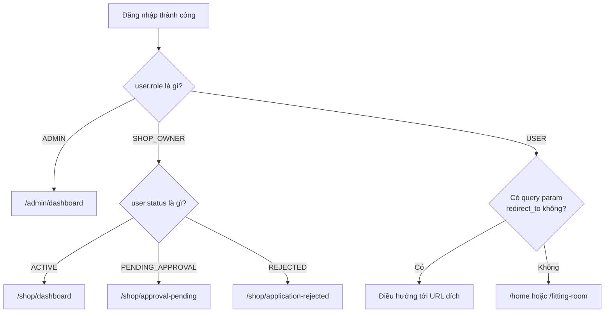

# MA TRẬN PHÂN QUYỀN (RBAC PERMISSION MATRIX) & ROUTE GUARDS
**Dự án:** FitVision3D / Fashion3D  
**Phiên bản:** 1.0.0  
**Mục tiêu:** Đồng bộ tuyệt đối giữa Backend Authorization và Frontend Navigation Guard

---

## 1. ĐỊNH NGHĨA CÁC VAI TRÒ (ROLES)

Trong hệ thống FitVision3D, mỗi tài khoản được gán đúng **một vai trò chính** (`role`):

1. **`ADMIN` (Quản trị viên hệ thống):**
   - Tài khoản có quyền lực cao nhất.
   - Quản trị toàn bộ người dùng, đối tác cửa hàng, kiểm duyệt mô hình 3D, cấu hình AI server và hạ tầng.
   - *Quy tắc cấp quyền:* Không có form đăng ký public. Chỉ tạo qua script Database Seeder hoặc được Super Admin cấp trực tiếp trong trang quản trị nội bộ.

2. **`SHOP_OWNER` (Chủ cửa hàng / Nhà bán lẻ thời trang):**
   - Đăng ký qua form đối tác bán lẻ (`/register/shop`).
   - Cần Admin phê duyệt hồ sơ (`status = ACTIVE`) mới được mở quyền truy cập hệ thống quản trị Shop.
   - Quyền hạn: Quản lý danh mục quần áo, upload file 3D mesh (`.obj`, `.gltf`), quản lý kích thước (size chart), xem thống kê người dùng thử đồ vào shop của mình.

3. **`USER` (Khách hàng / Người mua sắm):**
   - Đăng ký tự do qua form người dùng thông thường (`/register`).
   - Kích hoạt qua email/OTP.
   - Quyền hạn: Sử dụng tính năng quét AI đo kích thước cơ thể (AI-Tailor), tạo avatar 3D cá nhân, thử đồ ảo 3D, mua sắm và quản lý đơn hàng.

---

## 2. MA TRẬN PHÂN QUYỀN TÀI NGUYÊN (RESOURCE PERMISSION MATRIX)

Ký hiệu:
- :white_check_mark: : Cho phép truy cập / Thực thi
- :x: : Nghiêm cấm truy cập (Trả về `403 Forbidden` phía BE hoặc chuyển hướng trang phía FE)
- :warning: : Có điều kiện ràng buộc (Ví dụ: Chỉ thao tác với dữ liệu do chính mình tạo ra)

| Phân hệ / Tài nguyên | Hành động | Khách hàng (`USER`) | Chủ shop (`SHOP_OWNER`) | Quản trị viên (`ADMIN`) |
| :--- | :--- | :---: | :---: | :---: |
| **Xác thực & Hồ sơ** | Đăng ký, Đăng nhập, Quên mật khẩu | :white_check_mark: | :white_check_mark: | :white_check_mark: |
| | Cập nhật hồ sơ cá nhân, đổi avatar | :white_check_mark: | :white_check_mark: | :white_check_mark: |
| **Công nghệ AI 3D** | Upload ảnh đo đạc cơ thể (AI-Tailor) | :white_check_mark: | :white_check_mark: | :white_check_mark: |
| | Xem và tải về Avatar 3D cá nhân | :white_check_mark: | :white_check_mark: | :white_check_mark: |
| | Thử đồ 3D ảo trên sản phẩm của Shop | :white_check_mark: | :white_check_mark: | :white_check_mark: |
| **Quản trị Cửa hàng** | Xem thông tin hồ sơ Shop công khai | :white_check_mark: | :white_check_mark: | :white_check_mark: |
| | Cập nhật thông tin kinh doanh của Shop | :x: | :warning: (Chỉ shop mình) | :white_check_mark: |
| | Đăng sản phẩm thời trang & Upload 3D Mesh | :x: | :warning: (Chỉ shop mình) | :white_check_mark: |
| | Xem báo cáo doanh thu / lượt thử đồ | :x: | :warning: (Chỉ shop mình) | :white_check_mark: (Xem toàn sàn) |
| **Quản trị Nền tảng** | Phê duyệt / Từ chối hồ sơ Shop Owner | :x: | :x: | :white_check_mark: |
| | Khóa / Mở khóa tài khoản người dùng (`BANNED`)| :x: | :x: | :white_check_mark: |
| | Giám sát tài nguyên máy chủ & AI Worker | :x: | :x: | :white_check_mark: |
| | Cấu hình tham số hệ thống toàn cục | :x: | :x: | :white_check_mark: |

---

## 3. LOGIC ĐIỀU HƯỚNG SAU ĐĂNG NHẬP (POST-LOGIN REDIRECT)

Sau khi gọi API `/api/v1/auth/login` thành công, Frontend đọc thông tin `user.role` và `user.status` từ payload để điều hướng:



---

## 4. QUY CHUẨN THIẾT KẾ ROUTE GUARD PHÍA FRONTEND (CLIENT-SIDE)

Đồng nghiệp làm Frontend cần bọc các route bằng một HOC / Wrapper Component / Router Guard theo nguyên tắc sau:

### 4.1. Định nghĩa cấu trúc Route Meta
```typescript
// Định nghĩa Route trong Router (React Router / Vue Router / Next.js)
interface RouteConfig {
  path: string;
  isPublic?: boolean;                  // Trang công khai (Home, Product Detail)
  guestOnly?: boolean;                 // Chỉ cho khách chưa đăng nhập (Login, Register)
  requiredRoles?: Array<"ADMIN" | "SHOP_OWNER" | "USER">; // Quyền yêu cầu
}
```

### 4.2. Logic bảo vệ Route:
1. **Nếu `guestOnly = true` mà người dùng ĐÃ đăng nhập:**  
   $\rightarrow$ Chuyển hướng ngay về Dashboard tương ứng với Role của họ (tránh cho User đã đăng nhập lại vào form Login).
2. **Nếu trang yêu cầu đăng nhập (`isPublic = false`):**
   - Chưa đăng nhập $\rightarrow$ Chuyển hướng về `/login?redirect_to=` kèm URL hiện tại.
   - Đã đăng nhập nhưng Role hiện tại không nằm trong `requiredRoles` $\rightarrow$ Chuyển hướng sang `/403-forbidden`.
   - Nếu `role === 'SHOP_OWNER'` nhưng `status === 'PENDING_APPROVAL'` $\rightarrow$ Luôn giữ người dùng ở trang `/shop/approval-pending`.

---

## 5. QUY CHUẨN AUTHORIZATION PHÍA BACKEND (SERVER-SIDE)

Backend không bao giờ tin tưởng quyền từ Client gửi lên. Mỗi API được bảo vệ bởi 2 tầng Middleware:

### 5.1. Tầng 1: `AuthenticationGuard` (Xác thực danh tính)
- Trích xuất JWT Access Token từ Header: `Authorization: Bearer <token>`.
- Giải mã và xác thực chữ ký (Signature), kiểm tra thời hạn (`exp`).
- Kiểm tra tài khoản có bị `BANNED` trong Database/Redis hay không.
- Gắn thông tin User (`userId`, `role`, `status`) vào Context request (vd: `req.user`).

### 5.2. Tầng 2: `RolesGuard` (Kiểm tra quyền hạn)
- So sánh `req.user.role` với danh sách quyền được khai báo trên Controller/Route:
  - Nếu thỏa mãn: Cho phép đi tiếp vào Service handler.
  - Nếu không thỏa mãn: Ném lỗi `403 Forbidden` với mã lỗi chuẩn:
    ```json
    {
      "success": false,
      "data": null,
      "error": {
        "code": "FORBIDDEN_INSUFFICIENT_PERMISSIONS",
        "message": "Bạn không có quyền truy cập vào tài nguyên này."
      }
    }
    ```

