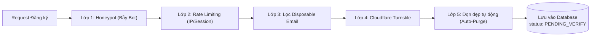
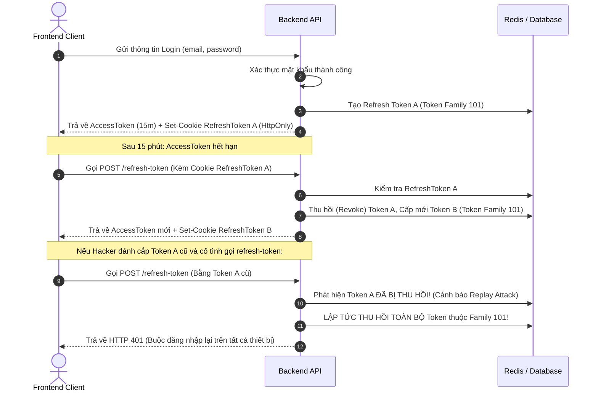

# ĐẶC TẢ BẢO MẬT & PHÒNG CHỐNG SPAM TÀI KHOẢN (SECURITY & ANTI-SPAM SPEC)
**Dự án:** FitVision3D / Fashion3D  
**Phiên bản:** 1.0.0  
**Tiêu chuẩn tuân thủ:** OWASP Top 10, OWASP ASVS v4.0, NIST SP 800-63B

---

## 1. TỔNG QUAN CÁC LỚP BẢO VỆ CHỐNG SPAM (DEFENSE-IN-DEPTH)

Hệ thống FitVision3D triển khai mô hình 5 lớp phòng thủ nhằm ngăn chặn triệt để hành vi dùng bot/script tự động tạo tài khoản ảo làm rác cơ sở dữ liệu:



---

## 2. CHI TIẾT 5 LỚP PHÒNG CHỐNG SPAM ĐĂNG KÝ

### 2.1. Lớp 1: Bẫy Bot tự động (Honeypot Technique)
- **Nguyên lý:** Bot tự động quét cây DOM và điền giá trị vào tất cả các input có trong form. Trong khi đó, người dùng thực tế sẽ không nhìn thấy input này trên màn hình.
- **Triển khai phía Frontend (FE):**
  Thêm một input ẩn vào form đăng ký:
  ```html
  <!-- Trường Honeypot: Ẩn hoàn toàn với mắt người dùng và trình đọc màn hình -->
  <div style="opacity: 0; position: absolute; top: 0; left: -5000px; height: 0; width: 0; z-index: -1;">
    <label for="extraNotes">Đừng điền vào ô này nếu bạn là người</label>
    <input 
      type="text" 
      id="extraNotes" 
      name="extraNotes" 
      tabindex="-1" 
      autocomplete="off" 
    />
  </div>
  ```
- **Xử lý phía Backend (BE):**
  Khi nhận request từ form:
  ```typescript
  // Nếu trường Honeypot có bất kỳ ký tự nào -> Chắc chắn là Bot
  if (req.body.extraNotes && req.body.extraNotes.trim() !== "") {
    // Chiến thuật "Silent Drop" (Phản hồi giả tạo thành công 200 để đánh lừa bot)
    // Hoặc trả về 400 Bad Request ngay lập tức mà không tốn tài nguyên hash mật khẩu.
    return res.status(200).json({
      success: true,
      message: "Đăng ký thành công. Vui lòng kiểm tra email của bạn."
    });
  }
  ```

---

### 2.2. Lớp 2: Giới hạn tần suất gọi API (Rate Limiting)
Triển khai bằng Redis (hoặc bộ nhớ Token Bucket trên API Gateway / Express / NestJS / FastAPI):

| Điểm cuối (Endpoint) | Mục tiêu áp dụng | Giới hạn tối đa | Hành động khi vi phạm |
| :--- | :--- | :--- | :--- |
| `POST /auth/register` | Theo Địa chỉ IP | **3 lần / 10 phút** | Trả về `429 Too Many Requests`. Khóa IP đó trong 30 phút. |
| `POST /auth/resend-verification` | Theo Email | **3 lần / 15 phút** | Trả về `429 Too Many Requests`. |
| `POST /auth/login` (Thất bại) | Theo IP + Email | **5 lần sai liên tiếp** | Bắt buộc gửi kèm `turnstileToken` hợp lệ mới cho thử tiếp. |
| `POST /auth/login` (Brute-force)| Theo IP + Email | **10 lần sai liên tiếp**| Trả về `423 Locked`. Khóa tạm thời 15 phút. |
| `POST /auth/forgot-password` | Theo IP | **5 lần / 1 giờ** | Trả về `429 Too Many Requests`. |

---

### 2.3. Lớp 3: Chặn tên miền Email tạm thời (Disposable / Temp Email)
Rất nhiều kẻ spam sử dụng các dịch vụ email 10 phút (như GuerrillaMail, Mailinator, 10MinuteMail, Temp-Mail) để đăng ký tài khoản ảo.

- **Cơ chế:** Backend duy trì một tập hợp (Set/Blacklist) các domain rác phổ biến. Khi đăng ký, bóc tách domain của email sau dấu `@` để kiểm tra.
- **Danh sách chặn mặc định (mở rộng liên tục):**
  ```typescript
  const DISPOSABLE_EMAIL_DOMAINS = new Set([
    "mailinator.com", "10minutemail.com", "tempmail.com", "guerrillamail.com",
    "throwawaymail.com", "getnada.com", "dispostable.com", "trashmail.com",
    "yopmail.com", "fakeinbox.com", "sharklasers.com", "guerrillamail.info",
    "grr.la", "temp-mail.org", "mohmal.com", "mytemp.email"
  ]);

  export function isDisposableEmail(email: string): boolean {
    const domain = email.split("@")[1]?.toLowerCase();
    return DISPOSABLE_EMAIL_DOMAINS.has(domain);
  }
  ```
- **Phản hồi khi vi phạm:** Trả về `400 Bad Request` kèm code `AUTH_DISPOSABLE_EMAIL`: *"Hệ thống không chấp nhận email tạm thời. Vui lòng sử dụng email chính thức."*

---

### 2.4. Lớp 4: Xác thực Người thật bằng Cloudflare Turnstile
Cloudflare Turnstile là giải pháp thay thế Google reCAPTCHA v3 hiện đại nhất:
- Không bắt người dùng giải đố hình ảnh (chọn đèn giao thông, xe bus gây khó chịu).
- Bảo vệ quyền riêng tư người dùng.
- Hoàn toàn miễn phí và tích hợp rất nhẹ.

#### A. Tích hợp Frontend:
```html
<script src="https://challenges.cloudflare.com/turnstile/v0/api.js" async defer></script>
<!-- Đặt widget vào form -->
<div class="cf-turnstile" data-sitekey="YOUR_TURNSTILE_SITE_KEY" data-callback="onTurnstileSuccess"></div>
```

#### B. Xác thực phía Backend:
Khi nhận `turnstileToken` từ Client, Backend gửi request kiểm tra tới máy chủ Cloudflare:
```typescript
const response = await fetch("https://challenges.cloudflare.com/turnstile/v0/siteverify", {
  method: "POST",
  headers: { "Content-Type": "application/x-www-form-urlencoded" },
  body: new URLSearchParams({
    secret: process.env.TURNSTILE_SECRET_KEY!,
    response: turnstileToken,
    remoteip: clientIp,
  }),
});
const outcome = await response.json();
if (!outcome.success) {
  throw new BadRequestException("AUTH_CAPTCHA_FAILED", "Xác thực bot không thành công.");
}
```

---

### 2.5. Lớp 5: Dọn dẹp tài khoản rác tự động (Auto-Purge Job)
- Dù có vượt qua các lớp trên, nếu tài khoản không hoàn tất xác thực OTP/Link kích hoạt sau **72 giờ**, tài khoản đó được xem là tài khoản bỏ rơi / spam.
- **Triển khai Cron Job:** Chạy định kỳ vào 03:00 sáng mỗi ngày:
  ```sql
  DELETE FROM users 
  WHERE status = 'PENDING_VERIFY' 
    AND created_at < NOW() - INTERVAL '72 HOURS';
  ```

---

## 3. TIÊU CHUẨN BẢO MẬT XÁC THỰC (AUTHENTICATION SECURITY STANDARDS)

### 3.1. Thuật toán mã hóa mật khẩu
- **Tiêu chuẩn ưu tiên 1:** `Argon2id` (Thuật toán vô địch cuộc thi Password Hashing Competition):
  - Memory cost: $65536$ KiB (64 MB)
  - Time cost: $3$ iterations
  - Parallelism: $4$ threads
- **Tiêu chuẩn ưu tiên 2:** `bcrypt` với cost factor (salt rounds) = **12**.
- *Tuyệt đối cấm:* Lưu mật khẩu dưới dạng plaintext, MD5, SHA-1, SHA-256 (kể cả có salt đơn giản).

---

### 3.2. Cơ chế JWT & Refresh Token Rotation (Chống đánh cắp phiên)



#### Ràng buộc kỹ thuật của Cookie:
- `HttpOnly`: Bắt buộc. Ngăn JavaScript truy cập cookie $\rightarrow$ Loại bỏ nguy cơ đánh cắp token qua lỗ hổng XSS.
- `Secure`: Bắt buộc khi chạy Production (Chỉ gửi cookie qua kết nối HTTPS).
- `SameSite=Lax`: Bảo vệ chống tấn công CSRF (Cross-Site Request Forgery).

---

### 3.3. Chống rò rỉ danh tính người dùng (Account Enumeration Defense)
- Tại form **Đăng nhập:** Khi sai thông tin, luôn trả về thông điệp chung: *"Email hoặc mật khẩu không chính xác."* (Không báo *"Email không tồn tại"*).
- Tại tính năng **Quên mật khẩu:** Kể cả khi email gửi lên không có trong hệ thống, hệ thống vẫn trả về `HTTP 200 OK` kèm câu: *"Nếu email của bạn đã đăng ký trên hệ thống, chúng tôi đã gửi hướng dẫn đặt lại mật khẩu về hòm thư."*
- Giữ độ trễ phản hồi đồng đều (Uniform Timing): Tránh trường hợp email tồn tại thì DB xử lý 200ms, email không tồn tại thì xử lý 10ms (kẻ tấn công có thể dựa vào thời gian để đoán email).

