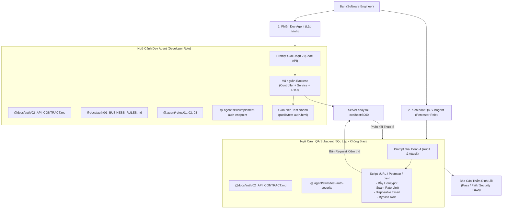

# KẾ HOẠCH CHIẾN LƯỢC PROMPTING THEO GIAI ĐOẠN & MÔ HÌNH SUBAGENT QA
**Dự án:** FitVision3D / Fashion3D  
**Mục tiêu:** Cung cấp lộ trình 5 giai đoạn, các mẫu prompt chuẩn, cách đưa file context vào `@`, và kỹ thuật kích hoạt Subagent QA độc lập để kiểm thử khách quan (chống thiên kiến).

---

## 1. SƠ ĐỒ KIẾN TRÚC: DEV AGENT VS SUBAGENT QA



---

## 2. KỸ THUẬT NẠP FILE NGỮ CẢNH VÀO PROMPT (CONTEXT BEST PRACTICES)

1. **Gõ ký tự `@` trên thanh chat:** Khi gõ `@`, Antigravity sẽ hiện danh sách file gợi ý trong workspace. Bạn chỉ chọn đúng các file liên quan đến tác vụ đang làm để giữ ngữ cảnh gọn gàng, sắc bén.
2. **Nguyên tắc "Nguồn chuẩn duy nhất" (Single Source of Truth):** Luôn nêu rõ file quy chuẩn quyết định:  
   *Ví dụ:* `"Nếu có điểm chưa rõ, luôn đối chiếu theo @docs/auth/02_API_CONTRACT.md làm chuẩn tối cao."*
3. **Kích hoạt Skill bằng cú pháp:** Nhắc tên skill trong prompt: `"Thực hiện theo các bước của skill @implement-auth-endpoint"`.

---

## 3. BỘ PROMPT MẪU 5 GIAI ĐOẠN (COPY-PASTE DÙNG NGAY)

---

### 🟢 GIAI ĐOẠN 1: Database Migration & Schema Setup
- **File context cần ghim:** `@.agent/rules/05-db-migration-rules.md`, `@docs/auth/01_BUSINESS_RULES.md`
- **Nội dung Prompt:**
```markdown
Bạn là Backend Database Specialist cho dự án FitVision3D.

Nhiệm vụ: Hãy tạo file Database Migration cho bảng `users` và bảng `shops`.

Yêu cầu bắt buộc:
1. Đọc kỹ và tuân thủ tuyệt đối quy chuẩn tại:
   - @.agent/rules/05-db-migration-rules.md (Quy tắc migration & schema chuẩn 2 bảng)
   - @docs/auth/01_BUSINESS_RULES.md (Vòng đời trạng thái tài khoản)
2. Bảng `users` phải có đầy đủ các cột:
   - `id`, `email`, `password_hash`, `full_name`
   - `role` (mặc định 'USER', ENUM/VARCHAR: ADMIN, SHOP_OWNER, USER)
   - `status` (mặc định 'PENDING_VERIFY', ENUM/VARCHAR: PENDING_VERIFY, PENDING_APPROVAL, ACTIVE, LOCKED, BANNED)
   - `failed_login_attempts` (mặc định 0), `lockout_until` (timestamp, nullable)
   - `last_login_at`, `created_at`, `updated_at`
3. Bảng `shops` (Quan hệ 1-1 với users):
   - `id`, `owner_id` (FK trỏ tới users.id), `shop_name`, `phone_number`, `shop_address`, `tax_code`, `logo_url`, `approved_at`.
4. Viết kèm script Seeder để tạo 1 tài khoản ADMIN mặc định (`admin@fitvision3d.com`).
```

---

### 🟢 GIAI ĐOẠN 2: Lập Trình Backend Endpoints (Auth Core)
- **File context cần ghim:** `@docs/auth/02_API_CONTRACT.md`, `@.agent/rules/01-auth-contract-rules.md`, `@.agent/rules/02-security-anti-spam-rules.md`, `@.agent/skills/implement-auth-endpoint/SKILL.md`
- **Nội dung Prompt:**
```markdown
Bạn là Senior Backend Engineer của dự án FitVision3D.

Nhiệm vụ: Hãy lập trình phân hệ Xác thực (Auth) gồm các endpoints:
1. `POST /api/v1/auth/register` (Đăng ký khách hàng)
2. `POST /api/v1/auth/register-shop` (Đăng ký chủ shop)
3. `POST /api/v1/auth/login` (Đăng nhập, cấp AccessToken và Cookie RefreshToken)
4. `POST /api/v1/auth/refresh-token` (Cấp mới token theo cơ chế Rotation)
5. `POST /api/v1/auth/logout` (Hủy cookie & revoke refresh token)

Yêu cầu kỹ thuật bắt buộc:
1. Đối chiếu chính xác theo:
   - @docs/auth/02_API_CONTRACT.md (Cấu trúc Response Envelope ApiResponse<T>, ErrorCode enum)
   - @.agent/rules/01-auth-contract-rules.md (JSON camelCase)
   - @.agent/rules/02-security-anti-spam-rules.md (Honeypot, Disposable Email, Rate Limiting)
2. Thực hiện theo đúng các bước trong:
   - @.agent/skills/implement-auth-endpoint/SKILL.md
3. Mật khẩu phải hash bằng Argon2id hoặc bcrypt (cost >= 12).
4. RefreshToken bắt buộc phải set vào Cookie với các cờ `HttpOnly; Secure; SameSite=Lax; Path=/api/v1/auth`.
5. Tạo middleware `requireAuth` và `requireRole('ADMIN', 'SHOP_OWNER')` để bảo vệ tài nguyên.
```

---

### 🟢 GIAI ĐOẠN 3: Dựng Mock Frontend Test Độc Lập
- **File context cần ghim:** `@docs/auth/02_API_CONTRACT.md`, `@docs/auth/05_FE_BE_SYNC_GUIDE.md`
- **Nội dung Prompt:**
```markdown
Bạn là Frontend Engineer. Hãy tạo một file HTML độc lập tại `public/test-auth.html` để tôi kiểm thử toàn diện các API Backend Auth vừa viết.

Yêu cầu:
1. Đọc contract tại @docs/auth/02_API_CONTRACT.md và schema tại @docs/auth/05_FE_BE_SYNC_GUIDE.md.
2. Dùng thư viện Axios qua CDN, bật cấu hình `withCredentials: true` để trình duyệt tự động gửi và nhận HttpOnly Cookie.
3. Thiết kế giao diện trực quan với 3 form:
   - Form Đăng ký User (có trường Honeypot `extraNotes` ẩn).
   - Form Đăng ký Shop Owner (có thêm shopName, phoneNumber, shopAddress).
   - Form Đăng nhập (có checkbox Remember Me).
4. Khu vực "Interactive Console":
   - Hiển thị Response trả về (Status, JSON Body).
   - Nút "Test Call Protected API (/auth/me)" (kiểm tra Bearer token).
   - Nút "Test Silent Refresh Token" (kiểm tra cơ chế refresh cookie).
   - Nút "Đăng xuất" (kiểm tra xóa cookie).
```

---

### 🟢 GIAI ĐOẠN 4: Kiểm Thử Độc Lập Bằng Subagent QA (Chống Thiên Kiến)
- **File context cần ghim:** `@docs/auth/02_API_CONTRACT.md`, `@.agent/skills/test-auth-security/SKILL.md`
- **Nội dung Prompt kích hoạt Subagent:**
```markdown
Hãy kích hoạt một Subagent độc lập đóng vai trò "Senior QA & Security Pentester" để kiểm thử độ an toàn của phân hệ Authentication vừa viết trên localhost:5000.

Yêu cầu đối với Subagent:
1. Subagent KHÔNG ĐƯỢC đọc code triển khai bên trong Backend mà CHỈ ĐƯỢC đọc:
   - @docs/auth/02_API_CONTRACT.md
   - @.agent/skills/test-auth-security/SKILL.md
2. Tiến hành chạy các kịch bản kiểm thử độc lập:
   - Kịch bản 1 (Honeypot Trap): Điền giá trị vào `extraNotes` -> Kiểm tra hệ thống có từ chối lưu vào DB không.
   - Kịch bản 2 (Spam Email): Dùng các email `test@mailinator.com`, `spammer@10minutemail.com` -> Kiểm tra có trả về đúng mã lỗi `AUTH_DISPOSABLE_EMAIL` không.
   - Kịch bản 3 (Brute-Force Rate Limit): Bắn liên tiếp 10 request sai mật khẩu -> Kiểm tra sau 5 lần có đòi Turnstile và sau 10 lần có khóa tài khoản 15 phút không.
   - Kịch bản 4 (Cookie Inspection): Kiểm tra header Set-Cookie của API Login có đủ cờ `HttpOnly`, `SameSite` không.
   - Kịch bản 5 (RBAC Privilege Escalation): Dùng token role USER gọi thử endpoint của SHOP_OWNER và ADMIN -> Phải nhận mã 403 `FORBIDDEN_INSUFFICIENT_PERMISSIONS`.
3. Xuất kết quả kiểm thử ra bảng đối chiếu: [Test Case | Input | Kết quả kỳ vọng | Kết quả thực tế | PASS/FAIL | Khuyến nghị sửa lỗi].
```

---

### 🟢 GIAI ĐOẠN 5: Đóng Gói & Chuẩn Bị Pull Request
- **File context cần ghim:** `@.agent/rules/04-git-collaboration-rules.md`, `@.env.example`, `@.gitignore`
- **Nội dung Prompt:**
```markdown
Tôi đã hoàn thành code và QA Subagent đã kiểm thử đạt 100% test cases.

Nhiệm vụ:
1. Đối chiếu theo @.agent/rules/04-git-collaboration-rules.md để kiểm tra xem có file nào chưa được ignore không (kiểm tra lại @.env.example và @.gitignore).
2. Tạo danh sách các commit theo chuẩn Conventional Commits (`feat:`, `test:`, `docs:`).
3. Viết nội dung mô tả Pull Request (PR Description) chi tiết gửi cho bạn Frontend:
   - Tóm tắt các endpoint đã mở.
   - Hướng dẫn bạn Frontend cách mở file `public/test-auth.html` để trải nghiệm thử.
   - Đính kèm link hợp đồng API @docs/auth/02_API_CONTRACT.md.
```

